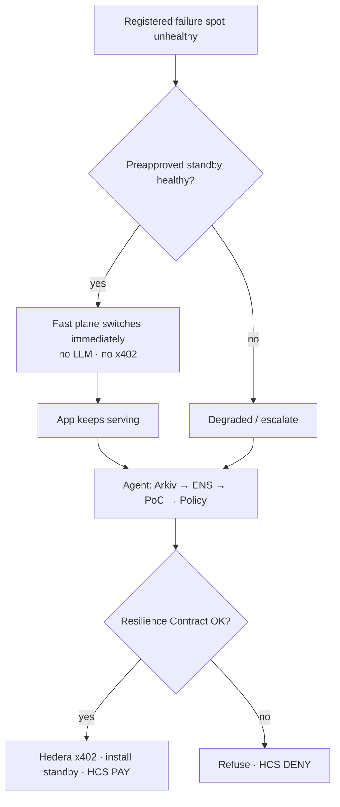

# NeverDown

### The Autonomous Resilience Operator for Web3

**ETHGlobal Mumbai 2026** · Repo: [github.com/dhanushonchain/NeverDown](https://github.com/dhanushonchain/NeverDown)

> Pick any failure spot in your stack. Program what NeverDown should do. Policy lives in a **Resilience Contract**. When that spot breaks, NeverDown recovers and — if needed — discovers, pays for, and installs a replacement, with proof.

NeverDown is a B2B **programmable resilience operator** for live dApps: **monitor → investigate → procure → recover → verify → audit**, inside explicit spend and action limits.

It is **not** “an RPC product.” RPC is only the **first demo vertical** (a concrete failure spot).  
It is **not** a chatbot that “tries to fix prod.”  
It is **general dependency resilience**: you attach NeverDown to a failure class, encode the playbook, and the two planes execute it.

**Coding agents / teammates:** start at **[AGENTS.md](AGENTS.md)** and **[docs/AGENT-CONTEXT.md](docs/AGENT-CONTEXT.md)** (progress, flow, next chunk, anti-RPC-only framing).

---

## Docs map

| Doc | What’s inside |
|---|---|
| **This README** | Product, prizes, demo, status, quick start |
| **[AGENTS.md](AGENTS.md)** | Short agent entrypoint |
| **[docs/AGENT-CONTEXT.md](docs/AGENT-CONTEXT.md)** | Full handoff: vision, flow, and chunk status |
| **[docs/TECHNICAL-AUDIT.md](docs/TECHNICAL-AUDIT.md)** | Source-verified architecture, frontend and release-readiness audit |
| **[docs/LOCAL-DEVELOPMENT.md](docs/LOCAL-DEVELOPMENT.md)** | Local mock demo and live testnet terminal guide |
| **[docs/LIVE-BACKEND-ACCEPTANCE.md](docs/LIVE-BACKEND-ACCEPTANCE.md)** | Live backend setup and acceptance evidence |
| **[docs/BUILD-CHUNKS.md](docs/BUILD-CHUNKS.md)** | **Detailed C0→C10 steps, gates, file ownership** |
| **[docs/C2-PAY-ONCE.md](docs/C2-PAY-ONCE.md)** | C2 buyer: env, `pnpm pay:once`, HashScan |
| **[docs/C3-POLICY-HCS.md](docs/C3-POLICY-HCS.md)** | C3 PolicyEngine + HCS: topic, smoke, Mirror |
| **[docs/C5-ARKIV.md](docs/C5-ARKIV.md)** | C5 Arkiv offers: seed, query, schema |
| **[docs/C7-POC.md](docs/C7-POC.md)** | C7 Proof-of-Capability before install |
| **[docs/C8-AGENT.md](docs/C8-AGENT.md)** | C8 Supreme Agent procure / deny CLI |
| **[docs/neverdown-architecture.md](docs/neverdown-architecture.md)** | Planes, components, flows, security honesty |
| **[docs/neverdown-architecture.excalidraw](docs/neverdown-architecture.excalidraw)** | Editable architecture diagram |

---

## Problem

Small DeFi / wallet / infra teams cannot run 24/7 ops. At 3 AM any **dependency** can fail: RPC, indexer, price API, oracle relay, bridge status endpoint, metadata host — not just one vendor category.

| What exists today | Gap |
|---|---|
| Monitoring / AI-SRE (alerts, guided remediation) | Doesn’t **buy** or install replacement capacity under policy |
| Single-purpose failover (e.g. RPC-only gateways) | Tied to one failure type; doesn’t generalize the playbook |
| Agent wallets (spend caps) | Rarely unify **payment + operational** permissions per dependency |

**NeverDown’s wedge:** for **any registered failure spot**, encode *what to do* in a **Resilience Contract**, recover fast on a preapproved path, then **procure** a replacement under policy — with an evidence trail.

---

## How it works (simple)

1. You map failure spots (dependency graph) and write a **Resilience Contract**: budget, allowlists, allowed actions, per-spot playbooks.  
2. The **fast plane** fronts that dependency (hackathon demo: JSON-RPC gateway).  
3. On health failure → switch to a **preapproved standby** instantly (no AI, no payment).  
4. The **Supreme Agent** replenishes capacity: **Arkiv** discover → **ENS** identity → **Proof-of-Capability** → **Hedera x402** pay if policy allows → install new standby.  
5. Bad seller / over budget → **refuse before sign** → **HCS DENY**.  
6. Dashboard shows HashScan, Arkiv entity, ENS name, and HCS receipts.

**Hackathon vertical = RPC** (sellers C1, pay C2, gateway C4). Same pattern applies to other failure spots later; the rails (policy, pay, audit) are shared.

---

## Two planes (most important diagram)



Full architecture: [docs/neverdown-architecture.md](docs/neverdown-architecture.md).

---

## Breakthrough features (product)

| Feature | One-line |
|---|---|
| **Resilience Contract** | On-chain / machine-enforceable playbook: budget, allowlist, allowed actions per failure spot |
| **Any failure spot** | RPC is the demo; same operator model for indexer, price API, oracle, etc. |
| **Dependency Graph** | Know which failures are critical vs noise (manifest-first for hackathon) |
| **Recovery before procurement** | Fast plane failover; agent replenishes capacity afterward |
| **Capability marketplace** | Arkiv offers for the capability type you need — not a generic agent bazaar |
| **Proof-of-Capability** | Live-test a candidate before activate |
| **Evidence Ledger** | HCS-anchored receipts + HashScan — independently checkable |
| **Bounded autonomy** | Observe / Recover / Privileged (human) |

---

## Prize stack

| # | Sponsor | Exact bounty | NeverDown use |
|---|---|---|---|
| 1 | **Hedera** | [AI Agents That Pay: x402](https://ethglobal.com/events/mumbai/prizes/hedera) ($6.5k) | Autopay replacement capacity (demo: RPC packs); budgets; HCS audit; HashScan proof |
| 2 | **Arkiv** | [Build on Arkiv (from scratch)](https://ethglobal.com/events/mumbai/prizes/arkiv) ($4k) | Expiring wallet-owned capability offers the agent queries |
| 3 | **ENS** | [Best Use of ENSv2](https://ethglobal.com/events/mumbai/prizes/ens) ($7k) | Seller/agent namespaces + text records gate the allowlist |

**Secondary (same app):** Hedera [No Solidity Allowed](https://ethglobal.com/events/mumbai/prizes/hedera) — SDK + HCS + accounts, zero Solidity.

**Skipped for MVP:** ATS/Stablecoin, Continuity, Swarm, Arc, 0G.

### Qualification we must hit

**Hedera x402**

- x402-protected endpoint on Hedera testnet via Official / Ax402 / Blocky402  
- Agent/client pays end-to-end with **no human approving**  
- README: setup, architecture, payment flow, **settled tx ID** + HashScan  
- Demo video ≤5 min  

**Extra points we target:** budgets, merchant allowlist, HCS spending audit.

**Arkiv**

- Write + **read** with `@arkiv-network/sdk` (not log-only)  
- README: writer wallet + one query  
- `/arkiv/schema.md`, `friction.md`, `reach.md`, `why-arkiv.md`, `how-you-use-arkiv.md`  

**ENSv2**

- Live resolve on Sepolia or mainnet — **central** to allowlist, not cosmetic  
- Demo + open source  

---

## Hackathon MVP: Self-Healing RPC Gateway

One demo app · three providers · one agent · one Resilience Contract.

| Act | What judges see |
|---|---|
| 1 | Healthy RPC through NeverDown gateway |
| 2 | Kill primary → standby restores (fast plane) |
| 3 | Agent discovers Arkiv offer → ENS → PoC → real x402 pay → new standby |
| 4 | Malicious / over-cap attempt → policy DENY before sign |
| 5 | Evidence: HashScan + Arkiv + ENS + HCS |

We run our **own** x402 RPC merchant to show the market mechanism — not claim a mature public x402 RPC market already exists.

**Stretch (after MVP):** wallet investigation tool → Guardian Drills → real contract analyzers.

---

## Build plan (chunked — do not boil the ocean)

We build **small chunks with hard gates**. Details for every step:

👉 **[docs/BUILD-CHUNKS.md](docs/BUILD-CHUNKS.md)**

| Chunk | Deliverable | Gate |
|---|---|---|
| **C0** | Monorepo scaffold | `pnpm install` — **done** |
| **C1** | Seller returns HTTP 402 | unpaid `POST /rpc` → 402 — **done + tested** |
| **C2** | Pay on Hedera testnet | `pnpm pay:once` → HashScan — **code done** (needs `HEDERA_SPEND_*`) |
| C3 | Policy + HCS PAY/DENY | Over-cap refuses |
| C4 | Gateway failover | Works with AI offline |
| C5 | Arkiv offers seed/query | Live query |
| C6 | ENSv2 allowlist | Fail closed |
| C7 | Proof-of-Capability | Bad RPC rejected |
| C8 | Agent wire-up | Act 3 + 4 via CLI |
| C9 | Console UI | Five-act clickable |
| C10 | Judge packaging | Ship checklist |

**Order:** rails (C1–C7) → agent (C8) → UI (C9) → packaging (C10).

---

## Repo layout

```
neverdown/
  apps/web/              # Console + demo UI          → C9
  apps/gateway/          # Fast Recovery Plane        → C4
  apps/sellers/          # x402 RPC merchant          → C1
  packages/core/         # Policy, agent, rails       → C2–C8
  docs/                  # Architecture + build guide
  arkiv/                 # Judge markdown             → C5 / C10
  .env.example
  LICENSE                # MIT
```

---

## Quick start

**Requirements:** Node.js 22.5+ (Node 22 LTS recommended).

```bash
git clone https://github.com/dhanushonchain/NeverDown.git
cd NeverDown
npm install
npm run dev
```

Open http://localhost:3000 for the homepage and http://localhost:3000/console.html for the five-act console. `npm run dev` starts only the web app; it does not start the gateway or seller.

Build and run the production web server:

```bash
npm run build
npm start
```

The repository also supports pnpm 9.15.0 as its canonical workspace manager:

```bash
corepack enable
corepack prepare pnpm@9.15.0 --activate
pnpm install --frozen-lockfile
pnpm dev
```

See [docs/LOCAL-DEVELOPMENT.md](docs/LOCAL-DEVELOPMENT.md) for the full gateway, seller, coordinator and safe demo sequence. Live backend configuration requires separate ignored environment profiles. Never commit environment files or private keys.

---

## Stack

| Layer | Choice |
|---|---|
| Monorepo | pnpm workspaces + TypeScript |
| Console | Node.js static HTML server + TypeScript API (C9) |
| Gateway | Node JSON-RPC proxy (C4) |
| Payments | `@x402/hedera` exact · `cryptoTransfer` |
| Discovery | `@arkiv-network/sdk` |
| Identity | ENSv2 (Sepolia/mainnet) |
| Audit | HCS + Mirror REST + HashScan |
| Agent | Tool loop (Vercel AI SDK / OpenAI-compatible) |

**Security honesty:** MVP = cap-funded spend wallet + server PolicyEngine + `cryptoTransfer`. We do **not** claim a stolen unrestricted key cannot spend. `transferExecutor` is later.

---

## What NeverDown is not

- Not a generic agent marketplace  
- Not unlimited production admin  
- Not a guarantee of any availability %  
- Not LLM-invented risk without chain evidence  
- Not Arc / 0G as primary prize rails for this build  

---

## Status

| Item | State |
|---|---|
| Product vision | Locked |
| Brand | **NeverDown** |
| C0 scaffold | **Done** |
| C1 x402 seller | **Done + tested** (22/22 unit tests) |
| C2 x402 pay-once | **Done + live HashScan settle** ([docs/C2-PAY-ONCE.md](docs/C2-PAY-ONCE.md)) |
| C3 PolicyEngine + HCS | **Done + tested** — `pnpm policy:smoke` ([docs/C3-POLICY-HCS.md](docs/C3-POLICY-HCS.md)) |
| C4 Gateway | **Code landed** (merged from remote) |
| C5 Arkiv offers | **Code done** — set `ARKIV_*`, then `pnpm arkiv:seed` / `arkiv:query` ([docs/C5-ARKIV.md](docs/C5-ARKIV.md)) |
| C6 ENSv2 allowlist | **Code done** (hermetic tests) |
| C7 Proof-of-Capability | **Done** — `pnpm poc:smoke` ([docs/C7-POC.md](docs/C7-POC.md)) |
| C8 Supreme Agent | **Done** — `pnpm agent:demo --scenario procure\|deny` ([docs/C8-AGENT.md](docs/C8-AGENT.md)) |
| C9 Console UI | **Done** — five-act console (`pnpm web:dev`) + evidence API |
| Live acceptance | **Passed** — see [docs/LIVE-EVIDENCE.md](docs/LIVE-EVIDENCE.md) |
| C10 Judge pack | **Baseline ready** — Arkiv md + demo/video checklists; tag `v0.1.0-demo` |
| Git remote | `https://github.com/dhanushonchain/NeverDown.git` |
| Maintainer | [ujjwaldubey1](https://github.com/ujjwaldubey1) |

### Live Hedera settlement (acceptance)

| Field | Value |
|---|---|
| Transaction ID | `0.0.9185802@1793985063.486076384` |
| HashScan | https://hashscan.io/testnet/transaction/0.0.9185802%401793985063.486076384 |
| Arkiv entity | `0x74867aaf0276debc7b151f1a40e6c1cd4e06d14018539f01112a17738a63310d` |
| ENS | `neverdown.eth` |
| Deny | `RECIPIENT_NOT_ALLOWLISTED` (no settle) |

Setup for live rails: [docs/LIVE-BACKEND-ACCEPTANCE.md](docs/LIVE-BACKEND-ACCEPTANCE.md) · one private root `.env` (migrate old profiles with `pnpm env:bootstrap`) · `pnpm preflight:live` · `pnpm agent:live`.

**Security honesty:** C3 payment worker isolation is **PARTIAL** (same-OS-user file access). See [docs/C3-SECURITY-GATE.md](docs/C3-SECURITY-GATE.md).

Built for **ETHGlobal Mumbai 2026**.
